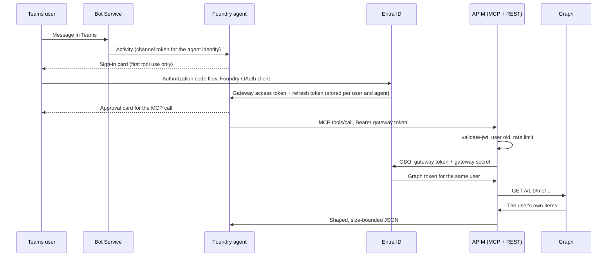

# Authentication: from a Teams user to Microsoft Graph

How a user of the `graph-mail-calendar` agent, published to Microsoft Teams, reads their own mail and calendar
through Microsoft Graph: each sign-in, token and swap on the way, and the source for each. The setup steps are in
the [Graph MCP runbook](graph-mcp.md); this page explains why they fit together.

Sources are Microsoft Learn pages, read on 2026-11-03, and the files of this repository. Statements that only this
repository supports are listed in [Not confirmed by Microsoft Learn](#not-confirmed-by-microsoft-learn).

## The rule behind the design

The only credential that ever reaches Graph is a **delegated token for the signed-in user**. It is obtained in two
steps:

1. Foundry gets the user a token for **the gateway**, not for Graph, through a custom OAuth connection.
2. APIM exchanges that token on behalf of the user (OBO) for a Graph token, on every call.

Foundry's managed OAuth refuses to send a token for a known Microsoft audience, such as Graph, to a custom MCP server
("Cannot pass Microsoft token to untrusted MCP endpoint"). A custom MCP server needs an audience you control, so the
gateway has its own `api://` audience and makes the Graph token itself.
([Set up authentication for MCP tools](https://learn.microsoft.com/azure/foundry/agents/how-to/mcp-authentication#oauth-identity-passthrough))



## The three app registrations

[`configure-graph-identity.ps1`](../scripts/configure-graph-identity.ps1) creates them, single tenant and tagged
`graph-mcp/<environment>/...`:

| App | Role in the flow | Configuration | Secret |
|---|---|---|---|
| Gateway `graph-mcp-<env>-gateway` | The API the user's token is for, and the client that makes the OBO call | `api://<gateway-client-id>` with one user scope `access_as_user`; v2 tokens; only the delegated Graph permissions `Mail.Read` and `Calendars.Read` | In Key Vault, read by APIM |
| Foundry OAuth client `graph-mcp-<env>-foundry` | The web client Foundry signs users in with | Requests the gateway's `access_as_user`; redirect is the exact callback the Foundry connection returns; no implicit grant | Only in the Foundry project connection |
| Local PKCE client `graph-mcp-<env>-local` | Direct tests outside Foundry | Public client, `http://localhost:8400/` loopback | None |

The helper records the Foundry and local client IDs in `GRAPH_ALLOWED_CLIENT_IDS`. The Bicep places them in the
gateway's `azp` check, so only those two clients can call the gateway.

## Step by step

### 1. From Teams to the Foundry agent

The platform does this step; nothing in this repository configures it.

- Publishing from the Foundry portal creates an Azure Bot Service resource, or shows the existing one, and adds the
  `activity` protocol and one Bot Service authorization scheme to the agent endpoint: **Just you** (`Shared`) maps to
  `BotServiceRbac`, **People in your organization** (`Tenant`) to `BotServiceTenant`.
- The Bot Service resource is registered with the agent's own identity (`instance_identity.client_id`). Foundry checks
  the signed channel token against that identity, then applies the tenant or RBAC check. The agent identity guards
  this hop only; it plays no part in reaching Graph.
- Users must be members of the project's tenant (guests are refused). With `BotServiceRbac` they need an Azure
  permission on the agent; **Foundry Agent Consumer** is the least-privilege built-in role, and the same role is
  needed for OAuth identity passthrough.

Sources:
[Publish in the Foundry portal](https://learn.microsoft.com/azure/foundry/agents/how-to/publish-copilot),
[Publish by using the REST API: steps 1, 3 and 5](https://learn.microsoft.com/azure/foundry/agents/how-to/publish-copilot-virtual-network),
[Configure agent endpoint authorization](https://learn.microsoft.com/azure/foundry/agents/how-to/configure-agent-endpoint-authorization#configure-bot-service-authorization),
[Troubleshoot publishing: runtime issues](https://learn.microsoft.com/azure/foundry/agents/how-to/troubleshoot-publish-copilot#resolve-runtime-issues),
[Foundry RBAC: agent-scope role assignments](https://learn.microsoft.com/azure/foundry/concepts/rbac-foundry#agent-scope-role-assignments);
this repository's [Teams publishing section](graph-mcp.md#publish-to-teams-and-microsoft-365-copilot).

### 2. First tool use: sign-in card and consent

- The agent's MCP tool points to the project connection `graph-mcp-oauth`, created by
  [`configure-foundry-agent.ps1`](../scripts/configure-foundry-agent.ps1): `authType: OAuth2`, the tenant's
  `/authorize` and `/token` endpoints, and the scopes `api://<gateway-client-id>/access_as_user offline_access`.
- The first time a user needs the tool, Agent Service returns a consent link, shown in Teams as a sign-in card. The
  user signs in with the Entra authorization code flow as the Foundry client and accepts *Read your own mail and
  calendar through the gateway*. Entra redirects to the Foundry callback, which is registered on the Foundry app.
- The user's tenant must match the project's; cross-tenant token exchange isn't supported.

Sources:
[Set up authentication for MCP tools: OAuth identity passthrough](https://learn.microsoft.com/azure/foundry/agents/how-to/mcp-authentication#oauth-identity-passthrough),
[Build and register an MCP server: the redirect URL Foundry provides](https://learn.microsoft.com/azure/foundry/mcp/build-your-own-mcp-server#connect-the-mcp-server-to-agent-service),
[Authorization code flow](https://learn.microsoft.com/entra/identity-platform/v2-oauth2-auth-code-flow),
[Scopes and permissions (`offline_access`)](https://learn.microsoft.com/entra/identity-platform/scopes-oidc).

### 3. Foundry stores the user's tokens

- Agent Service stores the user's access token and refresh token, scoped to that user and that agent, adds the access
  token to each later MCP request, and uses the refresh token when it expires. `offline_access` is what returns the
  refresh token, so later turns don't ask the user to sign in again.
- Authentication belongs to the connection: Foundry acquires, refreshes and injects the token on the service side.
  The agent definition holds no token and no per-user cache.

The gateway token's claims:

| Claim | Value |
|---|---|
| `aud` | The gateway's client ID, a GUID: in v2 tokens `aud` is always the API's client ID |
| `iss` | `https://login.microsoftonline.com/<tenant-id>/v2.0` |
| `azp` | The Foundry OAuth client |
| `scp` | `access_as_user` |
| `oid` | The user's object ID |

Sources:
[MCP authentication: Agent Service stores the user's credentials](https://learn.microsoft.com/azure/foundry/agents/how-to/mcp-authentication#oauth-identity-passthrough),
[Agent2Agent authentication: how OAuth identity passthrough works](https://learn.microsoft.com/azure/foundry/agents/concepts/agent-to-agent-authentication#oauth-identity-passthrough)
(the step-by-step storage and refresh description; the MCP page states it briefly),
[How toolbox authentication works](https://learn.microsoft.com/azure/foundry/agents/how-to/tools/tool-authentication),
[Access token claims reference](https://learn.microsoft.com/entra/identity-platform/access-token-claims-reference#payload-claims).

### 4. Approval, then APIM checks the token

- `require_approval=always` shows an approval card in Teams for each MCP call, separate from the OAuth consent. Only
  the four listed tools are allowed.
- Foundry sends the call to `https://<apim>/graph-mcp/mcp` with `Authorization: Bearer <gateway token>`. APIM's native
  MCP server maps each tool to an operation of the `graph-read` REST API, by the operation's full ARM ID.
- [`mcp.xml`](../infra/modules/api-management/policies/mcp.xml) and [`rest.xml`](../infra/modules/api-management/policies/rest.xml)
  both include the [`graph-authenticate`](../infra/modules/api-management/policies/authenticate.xml) fragment:
  - `validate-jwt`: signature from the tenant's OpenID metadata, expiry, audience, v2 issuer, `tid`, `ver=2.0`,
    `scp` containing `access_as_user`, `azp` in the approved list.
  - Exactly one valid user `oid`, and no `idtyp=app`: app-only tokens are refused. Entra emits `idtyp` only on
    app-only tokens by default, and delegated access is checked through `scp`.
  - A per-user limit of 60 calls in 60 seconds, counted on `oid`.

Sources:
[Connect agents to MCP servers](https://learn.microsoft.com/azure/foundry/agents/how-to/tools/model-context-protocol),
[About MCP servers in API Management](https://learn.microsoft.com/azure/api-management/mcp-server-overview),
[Expose a REST API as an MCP server](https://learn.microsoft.com/azure/api-management/export-rest-mcp-server),
[Secure access to MCP servers](https://learn.microsoft.com/azure/api-management/secure-mcp-servers),
[Validate JWT policy](https://learn.microsoft.com/azure/api-management/validate-jwt-policy),
[Policy fragments](https://learn.microsoft.com/azure/api-management/policy-fragments),
[Limit call rate by key](https://learn.microsoft.com/azure/api-management/rate-limit-by-key-policy),
[Validating claims: the actor](https://learn.microsoft.com/entra/identity-platform/claims-validation#validate-the-actor),
[Optional claims reference (`idtyp`)](https://learn.microsoft.com/entra/identity-platform/optional-claims-reference);
this repository's [`api-management/main.bicep`](../infra/modules/api-management/main.bicep) and
[`contract.json`](../infra/modules/api-management/contract.json).

### 5. APIM exchanges the token on behalf of the user

[`obo.xml`](../infra/modules/api-management/policies/obo.xml) sends this to
`POST https://login.microsoftonline.com/<tenant-id>/oauth2/v2.0/token`:

```text
grant_type=urn:ietf:params:oauth:grant-type:jwt-bearer
requested_token_use=on_behalf_of
client_id=<gateway-client-id>
client_secret={{graph-obo-secret}}
scope=https://graph.microsoft.com/.default
assertion=<the incoming gateway token>
```

- The assertion must be a token whose audience is the app making the request, which the gateway token is.
- `{{graph-obo-secret}}` is an APIM named value that points to Key Vault, without a pinned version. APIM reads it
  with its system-assigned managed identity, which holds **Key Vault Secrets User** on that one secret only. The
  vault keeps public network access disabled; APIM reaches it as a trusted Azure service. That identity reads the
  secret and nothing else; it never reads mail.
- Entra returns a Graph token for the **same user** (`oid`), with `azp` set to the gateway and at most the consented
  `Mail.Read` and `Calendars.Read`.
- Nothing is cached: every call makes a new exchange, with a 10-second timeout.
- Failures are mapped without returning Entra's error body or any claims challenge: `invalid_grant`,
  `consent_required`, `interaction_required` and `login_required` become **403 `graph_user_action_required`**;
  `invalid_client`, `unauthorized_client` and `invalid_scope` become **502 `obo_configuration_error`**, an operator
  problem, not user consent.

Sources:
[On-Behalf-Of flow: middle-tier access token request](https://learn.microsoft.com/entra/identity-platform/v2-oauth2-on-behalf-of-flow#middle-tier-access-token-request),
[Send request policy](https://learn.microsoft.com/azure/api-management/send-request-policy),
[Named values with Key Vault secrets](https://learn.microsoft.com/azure/api-management/api-management-howto-properties),
[Managed identities in API Management](https://learn.microsoft.com/azure/api-management/api-management-howto-use-managed-service-identity),
[Key Vault RBAC guide](https://learn.microsoft.com/azure/key-vault/general/rbac-guide),
[Key Vault networking: trusted services only](https://learn.microsoft.com/azure/key-vault/general/network-security#key-vault-firewall-enabled-trusted-services-only),
[Conditional Access and the on-behalf-of flow](https://learn.microsoft.com/entra/identity-platform/v2-conditional-access-dev-guide#scenario-app-performing-the-on-behalf-of-flow).

### 6. Graph returns only the user's own data

- [`rest.xml`](../infra/modules/api-management/policies/rest.xml) rebuilds each Graph URL from fixed parts:
  `https://graph.microsoft.com/v1.0/me/...`, a fixed `$select` and `$orderby`, and no caller OData.
- It removes `X-AnchorMailbox`, `X-HTTP-Method-Override` and `ConsistencyLevel`, so a caller can't point the request
  at another mailbox or change its method.
- `/me` is the user in the delegated token, so the token alone decides whose mailbox is read. Paging continuations
  also carry the user's `oid`, and one user's cursor is refused for another.
- Bodies are requested as text with `Prefer: outlook.body-content-type="text"`.

Sources:
[List messages](https://learn.microsoft.com/graph/api/user-list-messages?view=graph-rest-1.0),
[List calendarView](https://learn.microsoft.com/graph/api/calendar-list-calendarview?view=graph-rest-1.0),
[Get message: `Prefer` header](https://learn.microsoft.com/graph/api/message-get?view=graph-rest-1.0),
[Graph permissions reference](https://learn.microsoft.com/graph/permissions-reference).

## Two consents

| Consent | Who gives it | When |
|---|---|---|
| Foundry client to gateway (`access_as_user`) | The user | On the sign-in card, at first tool use |
| Gateway to Graph (`Mail.Read`, `Calendars.Read`) | Usually an administrator, under the tenant's consent policy | Before any user calls a tool |

OBO has no user interaction, so the second consent must exist before the call. Entra offers three ways: combined
consent (the gateway lists the client in `knownClientApplications` and the client requests `.default`),
preauthorized applications, or admin consent. This repository uses neither of the first two, and the identity helper
only declares the permissions, so the gateway-to-Graph consent is granted separately. Without it the user signs in
normally, but every tool call returns 403 `graph_user_action_required`.

Sources:
[On-Behalf-Of flow: protocol diagram](https://learn.microsoft.com/entra/identity-platform/v2-oauth2-on-behalf-of-flow#protocol-diagram),
[On-Behalf-Of flow: gaining consent for the middle-tier application](https://learn.microsoft.com/entra/identity-platform/v2-oauth2-on-behalf-of-flow#gaining-consent-for-the-middle-tier-application),
[Grant tenant-wide admin consent](https://learn.microsoft.com/entra/identity/enterprise-apps/grant-admin-consent),
[Permissions and consent overview](https://learn.microsoft.com/entra/identity-platform/permissions-consent-overview).

## Who holds what

| Identity | Credential | Can read mail |
|---|---|---|
| Teams user | Their Entra session, and the tokens Foundry stores for them | Only their own, through the chain above |
| Foundry OAuth client | Secret in the project connection | No: it only gets gateway tokens for a user |
| Gateway app | Secret in Key Vault | Only through OBO with a valid user token |
| APIM managed identity | Managed by the platform | No: it can read the one vault secret |
| Agent identity and Bot Service | Managed by the platform | No: they are not on the path to Graph |

## Revoking access

- Disable the project connection to stop the tools for everyone, including in Teams.
- Revoke a user's grants to stop that user; their stored refresh token stops working once the grant is gone or Entra
  revokes it.
- [Recovery and teardown](graph-mcp.md#recovery-and-teardown) covers credentials and the published agent.

Source: [Refresh tokens in the Microsoft identity platform](https://learn.microsoft.com/entra/identity-platform/refresh-tokens).

## Not confirmed by Microsoft Learn

- Users' networks must allow HTTPS to `*.azureml.ms` for the sign-in redirect. This comes from the
  [runbook prerequisites](graph-mcp.md#prerequisites); the Learn pages above don't state it.
- APIM forwarding the user's `Authorization` header from an MCP call to the REST operation behind it, so that the REST
  policy can make the OBO call, is a live acceptance gate in the
  [runbook](graph-mcp.md#live-acceptance-one-user-in-the-playground). One user reported the agent working in the
  Foundry playground on 2026-10-29; two-user isolation and the token-refusal cases are not yet tested.
- A [Microsoft Q&A answer](https://learn.microsoft.com/answers/a/12912519) supports per-user consent and token storage
  with OAuth identity passthrough. It is a community answer, not product documentation.
